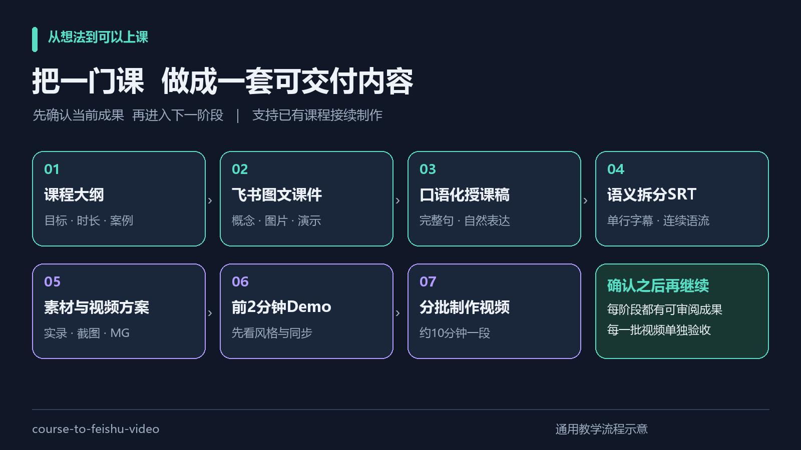
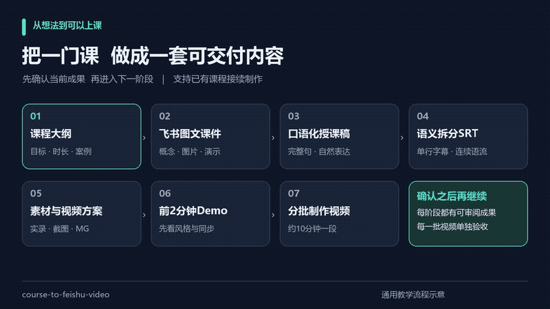
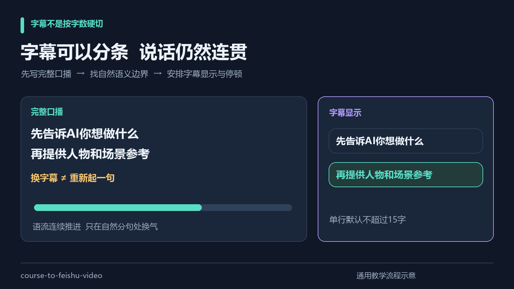

# course-to-feishu-video

一个用于制作教学课程的 Codex skill：从需求、大纲与飞书图文课件，到口语化授课稿、语义断句字幕、真实实操配词和逐批交付视频。



## 15秒看懂它怎么工作

[](docs/media/workflow-demo.mp4)

[查看或下载MP4演示视频](https://github.com/flemin86/course-to-feishu-video/raw/refs/heads/main/docs/media/workflow-demo.mp4) · 15秒 · 1280×720 · 30 fps · 无声

上面的动效是通用流程示意，展示技能如何组织制作，不是软件实录或课程成片。实际课程可结合录屏、真实截图、案例图片与MG动画制作。

## 工作流程

教学大纲及课时确认 → 飞书图文课件确认 → 授课稿确认 → SRT确认 → 素材及视频方式确认 → 前2分钟Demo确认 → 每批约10分钟，交付后逐批确认。

用户已经确认的内容可以接续，明确调整流程或批量授权时遵从最新要求。工具、课时、案例和输出规格可调整。

重点包括：字幕单行默认15字以内但不打断语流；自然分句和完整句使用不同气口；实操按真实视频重配台词并移动后续时间线；保护已确认前段；逐帧动画、准确标注框和实际MP4验收。

## 每一步会拿到什么

| 阶段 | 可审阅的成果 | 确认重点 |
| --- | --- | --- |
| 大纲 | 章节、案例与时间分配 | 教什么、给谁学、需要多久 |
| 飞书课件 | 图文课件、流程图与演示安排 | 内容顺序、图片与教学逻辑 |
| 授课稿与SRT | 口语化讲稿、可导入剪辑软件的字幕 | 语义完整、语速与气口自然 |
| 实操配词 | 对照真实录屏的讲解字幕 | 操作、修改思路与结果是否同步 |
| 视频制作 | 前2分钟Demo，随后约10分钟一批 | 画面、动效、标注与时间线衔接 |

### 字幕分条，不把一句话说断



例如“先告诉AI你想做什么，再提供人物和场景参考”，可以显示为两条单行字幕。说话按自然分句换气，字幕换条不会额外插入一次停顿。专业表达如 `sd2.5`、`16：9`、`1920*1080` 保持正确写法。

实操录屏也按实际操作配词：讲清当前问题、改了什么、为什么改，以及结果有什么变化。录屏比预留时间长时，后续内容整体衔接，已确认的前段保持不动。

## 安装和使用

将此仓库克隆或下载到 `~/.codex/skills/course-to-feishu-video`。如果目录已有旧版本，先备份并更新对应文件，避免重复安装。重新打开 Codex 会话后使用：

```bash
git clone https://github.com/flemin86/course-to-feishu-video.git ~/.codex/skills/course-to-feishu-video
```

```text
请使用 $course-to-feishu-video 制作课程
主题是…… 面向…… 预计……课时
先给教学大纲 我确认后再制作飞书图文课件
```

续作时提供当前成果和项目目录，即可从对应阶段继续。项目状态写在课程目录，不能写进技能目录。

## 文件

- `SKILL.md`：入口、确认节点和制作流程
- `references/`：字幕节奏、实操配词、视频验收和项目状态
- `scripts/audit_course_srt.py`：检查字幕结构、行长、间隔、口播文字及冻结前缀
- `scripts/shift_srt.py`：平移字幕时间，保留语义分条，拒绝覆盖旧文件
- `agents/openai.yaml`：Codex界面名称与默认提示词
- `docs/media/`：README专用的通用流程图、字幕示意与无声演示视频

辅助脚本使用 Python 3.9+ 标准库。SRT脚本不自动按15字强行截断，也不替代人工语义判断。

飞书需要环境中可用的文档连接或浏览器能力；视频制作需要可用的渲染与编码工具。该技能提供制作流程，不内置飞书授权、模型服务或视频生成服务。

## 数据边界

仓库包含通用技能和为说明流程制作的示意图片、动效。不包含私人课程剧本、实录、成片、私有飞书链接、账户凭据或个人素材路径。实际课程成果和状态应保存在独立项目目录；发布技能不代表授权公开课程素材。
